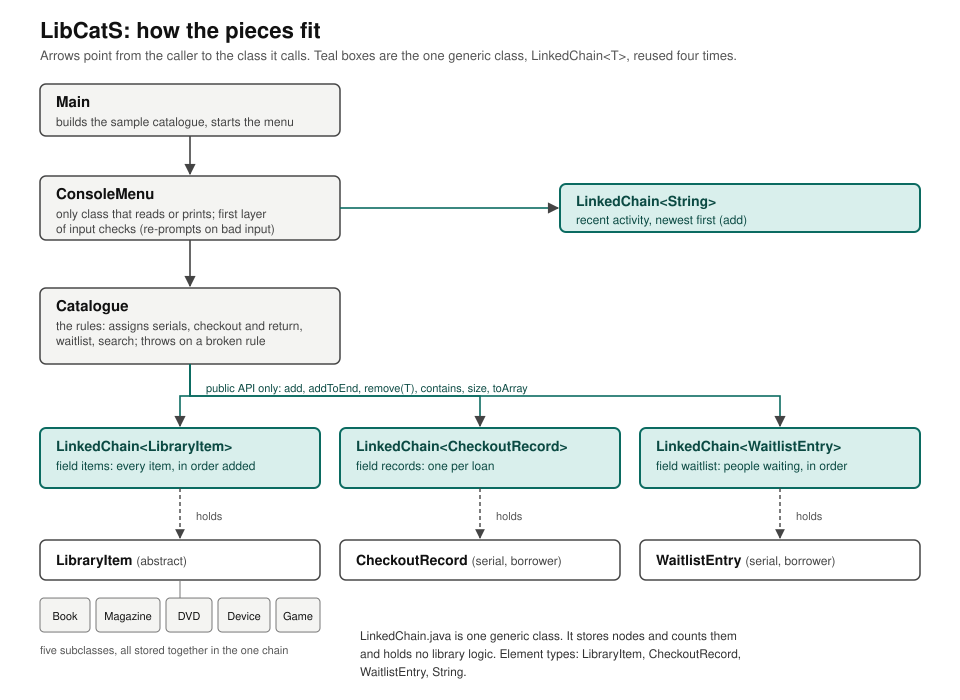

# LibCatS
Library Catalogue System (LibCatS) is a cataloguing system that can be used by libraries to organize their collection of items efficiently. Through this system, users can browse available items, view item details, and search for specific items. Users can also check out and return items to and from the catalogue. The catalogue maintains a record of all of the items and updates when an action is done. Users interact with this catalogue by entering commands into a console.

Group 89 (cs2114-project2-89). Project 2, Deliverable 4: Final Build.

**Status:** the program runs on the MVP path with a console menu, one generic `LinkedChain<T>` does all the storage, and **239 JUnit tests pass**. Two scope stretch goals work (extra descriptors with validation, and a waitlist). The system diagram is in [docs/system-diagram.svg](docs/system-diagram.svg) and below.

---

# Compilation and Running the Program

Run these from the repository root (the folder that contains `Classes/`, `Tests/`, and `lib/`). Java 11 or newer is needed (the code uses `String.repeat`; we checked that it compiles with `--release 11`).

**Compile** the program and the tests into a folder called `out`:

```bash
mkdir -p out
javac -d out -cp lib/junit-platform-console-standalone-1.10.2.jar Classes/*.java Tests/*.java
```

**Run the program** (it starts with a small sample catalogue of 15 items, 5 of them checked out):

```bash
java -cp out Classes.Main
```

**Run all the tests:**

```bash
java -jar lib/junit-platform-console-standalone-1.10.2.jar execute -cp out --scan-classpath
```

**In Eclipse:** the project already has `.classpath` set up with the JUnit jar. Run `Classes/Main.java` as a Java Application, and run the `Tests` package with *Run As > JUnit Test*.

## Using the menu

```
=== LibCatS Library Catalogue ===
[1]  Show all items                    [7]  Add an item
[2]  Show available items              [8]  Remove an item
[3]  Show checked-out items            [9]  Check out an item
[4]  Show checkout records             [10] Return an item
[5]  View details of one item          [11] Join the waitlist for a checked-out item
[6]  Search                            [12] Show recent activity
[0]  Exit
```

Items are found by **serial number** (shown in square brackets in the lists). Search can look by title, creator, serial number, or *any attribute* (genre, platform, description, ISBN, and so on). Press Ctrl+D at any prompt to leave cleanly.

---

## System diagram



`Main` starts `ConsoleMenu`, which calls `Catalogue`. `Catalogue` keeps all of its data in three `LinkedChain` objects, and `ConsoleMenu` keeps a fourth for recent activity. All four are the same generic class, `LinkedChain<T>`, holding four element types: `LibraryItem` (with five subclasses in one chain), `CheckoutRecord`, `WaitlistEntry`, and `String`. The application classes call it only through its public methods.

---

# Reflection

Where a change came from is tagged: **[Spec]** the written specification, **[Scope]** our Deliverable 1 scope, **[Group]** group discussion, **[Own]** a teammate's own reflection while building, and **[GenAI]** a problem found or a decision suggested during a GenAI-assisted review of the first build.

## Specification Changes

The first build was written from the per-class method tables in the spec (the second half). It did not follow the front half of the spec (Class Design, Invariants, Where Validation Lives, Revised Scope), so it contradicted six things the spec says we decided. This revision brings the code in line with the spec, and a few places where the spec contradicted itself or the scope were resolved as described.

| What the spec said | What the first build had | What we have now, and why |
| --- | --- | --- |
| Revised Scope 1: `LibraryItem` is **abstract**. | A concrete class; tests did `new LibraryItem(...)`. | `public abstract class LibraryItem` with an abstract `getType()`. The five subclasses extend it. Why: the shared title, creator, serial and `equals` are written once. **[Spec, Group]**. |
| Revised Scope 2: `ConsoleMenu` is the only class that reads or prints; `Main` only starts the program. | `Main` held half-written static menu code with the loop switched off (`running = false`). | New `ConsoleMenu(Catalogue, Scanner, PrintStream)` with the loop, every command and all input checks. `Main` builds the sample catalogue and calls `run()`. Jonathan's sample catalogue and list layouts were kept. Because input and output are passed in, `ConsoleMenuTest` can type a script of lines. **[Spec, Group]**. |
| Revised Scope 3: loans are a chain of `CheckoutRecord(serial, borrower)`; the `record` field is removed from `LibraryItem`; an item is out if and only if a record with its serial exists. | `LibraryItem` had a `record` field **and** `CheckoutRecord` had an `id` and an `item`: two sources of truth. | `LibraryItem.record`, `getRecord` and `setRecord` are gone. `CheckoutRecord` holds `final int serial` and `borrower`. `Catalogue` answers "is it out?" by looking for the record (`isCheckedOut`, `getBorrower`). `getCheckoutRecord(int)` now takes a serial. **[Spec]**. |
| Revised Scope 4: no no-argument constructors. | All 5 subclasses, `LibraryItem` and `CheckoutRecord` had one (and a test expected "N/A" output from a blank item). | All removed. A blank item or record can no longer exist. **[Spec]**. |
| Revised Scope 5: subclass constructors take title and creator first. | Subclasses already took title, creator, description, then their descriptors, but never checked any of them. | Same parameter order. Every constructor and setter now validates: title and creator are non-blank and at most 100 characters; description may be empty but not null; String descriptors are non-blank; counts (`pageCount`, `numEpisodes`) are greater than 0. A rejected setter keeps the old value. **[Spec]**. The spec's constructor table omits `description`; we kept it because the spec's Data and State section lists it as an attribute. |
| Where Validation Lives: three layers (menu re-prompts, domain classes backstop, `LinkedChain` guards storage). | No menu layer. `LibraryItem` accepted blank and 150-character text. | Layer 1 is `ConsoleMenu.readNonBlank`, `readInt` and `readPositiveInt`. Layer 2 is the constructors and setters above, `CheckoutRecord`, `WaitlistEntry` and `Catalogue`. Layer 3 is `LinkedChain`. See the bad-input table below. **[Spec]**. |
| Response convention: a broken rule throws `IllegalStateException` with a message the menu prints as written. The Catalogue method table said `borrowItem` and `returnItem` return false for the same case. | `borrowItem` and `returnItem` returned false, so the user was never told who has the item. | The spec contradicts itself, so we followed the convention and the scope ("the program shows who has it"). `borrowItem` and `returnItem` throw `IllegalStateException` ("Item 3 is already checked out to Sam." / "Item 1 is not checked out.") and return `false` only when the item is not in this catalogue. They still return `boolean`, so the signature in the spec's table is unchanged. **[Spec, Scope]**; the group should confirm this call. |
| Catalogue assigns serials from `nextSerial` (starts at 1), never reused; 0 means "not yet assigned". | Serials came from a static counter inside `LibraryItem` that started at 0 and counted every item ever created, even ones never added. | `Catalogue.addItem` assigns the serial through a package-private `LibraryItem.assignSerial`, so tests and menu code cannot set or change a serial. `addItem` now returns the serial. Adding the same object twice throws `IllegalStateException`. **[Spec]**. |
| Invariant: "An item with a record cannot be removed." (and the scope: "refused until it is returned"). | `removeItem` removed it anyway and left an orphaned record. A later change by Jonathan made `removeItem` quietly return the item first, which silently ended someone's loan. | `removeItem` throws `IllegalStateException("Item 3 is checked out to Sam and cannot be removed until it is returned.")`. It returns `false` if the item is not there, and clears that item's waitlist when it is removed. **[Spec, Scope]**. |
| `getItemsByTitle` and `getItemsByCreator` are O(n). | They called `items.get(i)` in a loop. `LinkedChain.get` is O(n), so they were O(n squared) (measured 198 ms at 16,000 items). They also crashed with a `NullPointerException` on an item with a null title. | Both copy the chain once with `toArray` and scan the array: O(n). Matching ignores case. A null or blank argument throws `IllegalArgumentException`. **[GenAI]** review (found while checking the Big-O estimates). |
| (Not in the spec.) Jonathan's `getAllReturnedItems` and `getAllBorrowedItems`. | They used `java.util.ArrayList` and cast `toArray()` to `LibraryItem[]`, which throws `ClassCastException` the first time it runs. | Rewritten to store results in a `LinkedChain` and use `toArray(new LibraryItem[...])`, so the chain still does the storage. The names `getAllItems`, `getAllReturnedItems` (items that are available), `getAllBorrowedItems` and `getAllCheckoutRecords` are Jonathan's and were kept. **[Group]** (Jonathan's methods); the problem was found in review. |
| (Not in the spec.) `isValidID()` and `isValidSerial()` helpers. | Private helpers in `Catalogue` that scanned the chains with `get(i)`. | Removed. `getItem` and `getCheckoutRecord` throw `IndexOutOfBoundsException("No such item: N")` for any serial that matches nothing (including 0 and negatives), which the scope asks for. **[Scope]**. |
| (Not in the spec.) | n/a | New methods: `Catalogue.searchItems` (the scope's "search by other attributes"), `isCheckedOut`, `getBorrower`, and the waitlist methods; `LibraryItem.matches`, `summary`, `getType`; `Book.setIsbn`, `Magazine.setDateOfIssue`; new class `WaitlistEntry`. These come from the scope's MVP and stretch goals. **[Scope]**. |
| Test plan: a normal case and a bad-input case for every public method. | The five subclass tests had no bad-input tests, `LinkedChain` had no test file, and nothing tested the menu. | Added bad-input tests for every subclass constructor and setter, `LinkedChainTest`, `WaitlistEntryTest`, `ConsoleMenuTest`, `MainTest`; `CatalogueTest` and `CheckoutRecordTest` were rewritten for the new rules. **[Spec]**. |
| `setCheckoutRecord` "throws InvalidClassException" for a wrong type; setters "keep the old value if not a String". | n/a | Java's types already stop a wrong type at compile time, and `InvalidClassException` is about file serialization, so neither is testable. We test the real bad inputs instead (null, blank, too long, not positive). The field itself no longer exists (Revised Scope 3). **[Own]**. |

## LinkedChain Changes

We changed the provided class in two ways, both promised in the spec (Data and State, and The Generic Contract), and used everything else unchanged. **[Spec, Group]**.

1. **Tail reference.** We added `private Node<T> lastNode`. `add` sets it when the chain was empty, `addToEnd` links onto it instead of walking the chain, and `remove()`, `remove(T)` and `clear()` keep it correct (removing the last entry moves it back, removing the only entry sets it to null). This makes `addToEnd` **O(1) instead of O(n)**, which matters because `Catalogue` appends on every add. The class comment and the Big-O list were updated to match. `LinkedChainTest.testRemoveEntryFirst`, `testRemoveEntryLast` and `testRemoveEntryOnly` test the three cases that can break the tail, one by one, as the scope asks.
2. **`add(null)` and `addToEnd(null)` return `false`** and leave the chain unchanged, instead of throwing. This is what the spec's Generic Contract promises. The private `requireNonNull` helper was removed. `Catalogue.addItem(null)` still throws `IllegalArgumentException("Item cannot be null")` so a null is never silently dropped.

Unchanged: `get` is still O(n). The spec's method table says O(1), which is wrong for a singly linked chain, so the estimate in the table was not met and we instead made `Catalogue` copy a chain to an array once with `toArray` before scanning it. `Catalogue` and `ConsoleMenu` use the chain only through its public methods (`add`, `addToEnd`, `remove(T)`, `contains`, `size`, `toArray`); `get`, `count`, `clear`, `isEmpty`, `remove()` and `toString` are not needed by the application and are covered by `LinkedChainTest`.

### How the one generic class is reused

| Chain | Element type | Where | What it holds |
| --- | --- | --- | --- |
| `LinkedChain<LibraryItem>` | `LibraryItem` | `Catalogue.items` | `Book`, `Magazine`, `DVD`, `Device` and `Game` objects, together, in the order added |
| `LinkedChain<CheckoutRecord>` | `CheckoutRecord` | `Catalogue.records` | one record per loan |
| `LinkedChain<WaitlistEntry>` | `WaitlistEntry` | `Catalogue.waitlist` | people waiting for checked-out items, in order joined |
| `LinkedChain<String>` | `String` | `ConsoleMenu.history` | recent actions (`add` puts the newest at the front, so `toArray` returns newest first) |

That is **four different element types, plus five concrete item classes in one chain, through the same class with no type-specific copies.** Tests: `MainTest.testCreateSampleCatalogue` (five item types in one chain), `CatalogueTest` (mixed items), `LinkedChainTest.testManyElementTypes`.

## Unknowns (what happened to what we didn't know how to do)

| Unknown from our scope | Outcome |
| --- | --- |
| Abstract class or interface for the item types? | **Figured out: abstract class.** An interface cannot hold the shared title, creator and serial, so five subclasses would repeat them, and an abstract class lets `equals` and validation be written once. `getType()` is the abstract method; each subclass overrides it, `toString` and `searchText`. **[Group]** decision, after asking GenAI the tradeoff question. |
| How to write `equals()` so removal works when two copies share a title? | **Figured out.** `LibraryItem.equals` and `hashCode` use the serial only (an item with no serial yet equals only itself), and `CheckoutRecord.equals` uses the serial. `CatalogueTest.testRemoveItemOneOfTwoCopies` removes one of two copies of the same book and checks the other is untouched. The first build overrode `equals` without `hashCode`; fixed. |
| How to handle bad input and a closed input stream with `Scanner`, including `InputMismatchException`? | **Figured out.** `ConsoleMenu` only reads with `hasNextLine` and `nextLine` and converts numbers with `Integer.parseInt`, catching `NumberFormatException`, so there is no `InputMismatchException` and no bad token left in the buffer. A closed or empty stream (or a closed `Scanner`) becomes a private `EndOfInput` exception that `run()` turns into "Goodbye." and a normal return. Covered by `testNonNumericChoice`, `testRunEmptyInputStream`, `testRunClosedScanner`, `testRunInputEndsMidCommand`. |
| How to split the program so the menu code stays separate from the chain? | **Figured out.** `LinkedChain` stores only; `Catalogue` holds the rules; `LibraryItem` and the subclasses describe themselves; `CheckoutRecord` and `WaitlistEntry` hold single facts; `ConsoleMenu` is the only class that reads or prints; `Main` wires them together. Who wrote what is in the Attribution table. |
| Biggest risk: getting `LinkedChain` right. | **Handled.** `LinkedChainTest` (28 tests) covers every public method, with the first, last and only entry removed one by one. It found no bugs in the provided chain, and the tail reference we added passes the same tests. |

**Still open:** saving and loading a file, and due dates, are scope stretch goals we did not build (see Next Steps). The scope says `LocalDate` is "in the java.lang package"; it is actually `java.time.LocalDate`, so the import will be different when we build due dates.

## What Doesn't Work Yet

* **Not built:** the stretch goals "save and load the catalogue to a file" (dropped on purpose) and "due dates with an overdue report" (planned, not finished). The catalogue resets to the sample data every time the program starts.
* There is **no menu command to edit an item** after it is added. The setters exist and are tested, but the menu cannot reach them, so a mistyped ISBN or genre can only be fixed by removing and re-adding the item.
* `Book` has an ISBN and a `publisher`; `Magazine` has a date of issue but not the "type of information" (Lifestyle, Sports) beyond `genre`.
* **Searching by title or creator needs the whole title or name** (ignoring case). Partial words are found through "any attribute" search (option 6, then 4).
* **Speed:** the lists in options 1 to 3 and `getAllReturnedItems` / `getAllBorrowedItems` are O(n times r), because each item looks for its record in the records chain. That is fine at library scale but not O(n).
* `Catalogue` decides "is this item in the catalogue" with `items.contains`, which compares serials. This is safe with one `Catalogue` per program (as in `Main`), but an item from a second `Catalogue` that has the same serial would be treated as present.
* `ConsoleMenu` prints prompts without a newline, so output captured from piped input looks run together (it looks normal in a terminal).
* The spec's UML shows no `WaitlistEntry`, `searchItems`, or `ConsoleMenu`; the spec document should be updated to match this README before the final.

---

# Big-O of the application methods

n = items, r = records (loans), w = waitlist entries, k = people waiting for one item (usually 0). All timings below are from a throwaway benchmark (not committed) on 5,000 to 40,000 items: adding 40,000 items took about 1 ms in total; `getItemsByTitle` on 40,000 items took about 0.12 ms and did not grow faster than the item count. For comparison, the first build's `getItemsByTitle` took 198 ms at only 16,000 items because it was O(n squared).

| Method | Spec estimate | Actual | Matches the spec? | Reason |
| --- | --- | --- | --- | --- |
| `Catalogue()` | O(1) | O(1) | Yes | creates three empty chains |
| `addItem` | (not listed) | O(1) | n/a | assigns a serial and `addToEnd` is O(1) with the tail reference |
| `removeItem` | (not listed) | O(n + r + w + k·w) | n/a | `contains`, find the record, then remove each waiting entry |
| `getAllItems` | (not listed) | O(n) | n/a | one `toArray` |
| `getAllReturnedItems`, `getAllBorrowedItems` | (not listed) | O(n·r) | n/a | each item scans the records snapshot |
| `getItemsByTitle`, `getItemsByCreator` | O(n) | O(n) | **Yes** (after the fix; the first build was O(n²)) | one `toArray`, then one scan |
| `searchItems` | (not listed) | O(n) for text of bounded length | n/a | one scan, `matches` looks at a few short strings |
| `getItem` | O(n) | O(n) | Yes | one scan |
| `getCheckoutRecord`, `getCheckoutRecords` | O(n) | O(r) | Yes (r ≤ n, so it is tighter) | one scan of the records |
| `getAllCheckoutRecords`, `isCheckedOut`, `getBorrower` | (not listed) | O(r) | n/a | one scan of the records |
| `borrowItem` | **O(1)** | O(n + r + w) | **No** | the spec assumed an `item.record` field; Revised Scope 3 removed it, so we must check `items.contains`, search the records for a loan, and check the waitlist |
| `returnItem` | O(n) | O(n + r), which is O(n) because r ≤ n | Yes | `contains`, find the record, `remove` |
| `joinWaitlist` | (not listed) | O(n + r + w) | n/a | same checks as `borrowItem`, plus a `contains` on the waitlist |
| `getWaitlist`, `getNextInLine` | (not listed) | O(w) | n/a | one scan of the waitlist |
| `LibraryItem` getters and setters, subclass getters and setters, `CheckoutRecord` and `WaitlistEntry` methods | O(1) | O(1) | Yes | fixed number of fields; text checks look at one short string |
| `LibraryItem.matches`, `toString`, `summary` | (not listed) | O(L), L = text length | n/a | build or search a short string |
| `Book.setIsbn`, `Magazine.setDateOfIssue` | (not listed) | O(1) | n/a | at most 13 characters; one date parse |
| `LinkedChain.add`, `remove()`, `clear`, `size`, `isEmpty` | O(1) | O(1) | Yes | |
| `LinkedChain.addToEnd` | O(n) in the spec table, O(1) in the spec's Data and State | **O(1)** | Matches the Data and State section | tail reference |
| `LinkedChain.remove(T)`, `contains`, `count`, `toArray`, `toString` | O(n) | O(n) | Yes | |
| `LinkedChain.get` | **O(1)** | O(n) | **No** | the spec is wrong for a singly linked chain; the provided class says O(n) |
| `ConsoleMenu` commands | (not listed) | each one is dominated by the Catalogue call it makes; the three list commands are O(n·r) | n/a | |

---

# Bad input

Each case from the scope gets the response the spec's Where Validation Lives section names, and each has a test.

| Bad input (from the scope) | Caught by | Response | Test |
| --- | --- | --- | --- |
| Blank or whitespace-only title or creator on add | `ConsoleMenu.readNonBlank`; backstop `LibraryItem` constructor and setters | Prints "Text cannot be blank. Please try again." and asks again. Backstop: `IllegalArgumentException("Title cannot be blank")` | `ConsoleMenuTest.testAddBadInputIsReprompted`, `LibraryItemTest.testConstructorBadInput` |
| Menu choice or serial that is not a number | `ConsoleMenu.readInt` | Prints "That is not a number. Please try again." and asks again | `testNonNumericChoice`, `testShowDetailsBadInput` |
| A number that is not on the menu | `ConsoleMenu.carryOut` | "Please choose a number from the menu." | `testUnknownChoice` |
| Serial that matches no item (including 0 and negative) | `Catalogue.getItem` | `IndexOutOfBoundsException("No such item: 0")`, printed by the menu | `CatalogueTest.testGetItemBadInput`, `ConsoleMenuTest.testShowDetailsBadInput` |
| Checking out an item that is already out | `Catalogue.borrowItem` | `IllegalStateException("Item 3 is already checked out to Sam.")`; no record added | `CatalogueTest.testBorrowItemAlreadyOut`, `ConsoleMenuTest.testBorrowItemAlreadyOut` |
| Returning an item that is not checked out | `Catalogue.returnItem` | `IllegalStateException("Item 1 is not checked out.")`; both chains unchanged | `testReturnItemNotOut` (both test classes) |
| Removing an item that is checked out | `Catalogue.removeItem` | `IllegalStateException("... cannot be removed until it is returned.")` | `testRemoveItemCheckedOut` (both test classes) |
| Search with no matches | `Catalogue` search methods; `ConsoleMenu.search` | empty array; the menu prints "Nothing found." | `ConsoleMenuTest.testSearchNothingFound`, `CatalogueTest.testGetItemsByTitle` |
| Title, creator or borrower over 100 characters | `ConsoleMenu.readNonBlank`; backstops in `LibraryItem`, `CheckoutRecord`, `WaitlistEntry` | "Text is over 100 characters. Please try again." Backstop: `IllegalArgumentException("Title is over 100 characters")` | `testAddBadInputIsReprompted`, `testAddOverlongCreator`, `testBorrowItemBadInput` |
| Very long garbage or special characters | by design, not a check: lines are read whole with `nextLine`, printed with `println`, compared with plain `String` methods, never used as a format or pattern | treated as ordinary text, no crash | `ConsoleMenuTest.testGarbageInput`, `CatalogueTest.testSearchItemsBadInput`, `LibraryItemTest.testMatchesBadInput` |
| Closed or empty input stream (Ctrl+D) | `ConsoleMenu.readLine` (private `EndOfInput`) | prints "Goodbye." and returns normally | `testRunEmptyInputStream`, `testRunClosedScanner`, `testRunInputEndsMidCommand`, `MainTest.testMainEmptyInput` |
| Rapid repeated adds of the same item | allowed; `Catalogue.addItem` | each copy gets a new unique serial | `testRapidRepeatedAdds`, `CatalogueTest.testAddItemDuplicateCopies` |
| Remove from an empty chain, or remove an item that is not present | `LinkedChain.remove(T)`; `Catalogue.removeItem` | returns `false`, chain unchanged | `LinkedChainTest.testRemoveEntryBadInput`, `CatalogueTest.testRemoveItemNotThere` |
| Add null | `LinkedChain.add` and `addToEnd`; `Catalogue.addItem` | the chain returns `false` and is unchanged; `Catalogue.addItem(null)` throws `IllegalArgumentException("Item cannot be null")` | `LinkedChainTest.testAddBadInput`, `testAddToEndBadInput`, `CatalogueTest.testAddItemBadInput` |
| Get an index out of range | `LinkedChain.get` | `IndexOutOfBoundsException` | `LinkedChainTest.testGetBadInput` |
| Search an empty chain | `LinkedChain.toArray`; `Catalogue` search methods | empty array | `CatalogueTest.testConstructorEmptyCatalogue` |
| Remove the first, last and only item | `LinkedChain.remove(T)` | chain stays correct | `LinkedChainTest.testRemoveEntryFirst`, `testRemoveEntryLast`, `testRemoveEntryOnly` |
| Anything unexpected | `ConsoleMenu.run` wraps every command | prints "Something went wrong. Returning to the menu." and keeps running | `ConsoleMenuTest.testUnexpectedExceptionKeepsRunning` |

---

# Final Status

The MVP from the scope is finished and tested (add and remove items with title, creator and serial; summary with availability; details of one item; search by title, serial or other attributes; separate available and checked-out categories; who has each item).

## Stretch Goals
From the four in our scope:

* **Extra descriptors with validation: built and working.** ISBN for books with the check-digit rule, `Book.publisher`, and date of issue for magazines checked for being a real date (`Book.setIsbn`, `Book.isValidIsbn`, `Book.setPublisher`, `Magazine.setDateOfIssue`, `Magazine.isValidDate`). The add flow in the menu asks for them and re-prompts on bad input.
* **Waitlist for checked-out items: built and working.** A queue of waiting borrowers per item and a notice to the next person on return (`WaitlistEntry`, `Catalogue.joinWaitlist`, `getWaitlist`, `getNextInLine`; menu option 11).
* **Due dates with an overdue report: not built.** We planned it in Deliverable 3 and ran out of time.
* **Save and load the catalogue to a file: dropped.** Reading and parsing a file correctly and handling a missing or corrupted file is the largest of the four goals.

Also not built from the Deliverable 3 plan: a menu command to edit an item after it is added (the validated setters exist and are tested), and a separate "type of information" for `Magazine`.

---

# Attribution

This table lists who worked on each file and how, from the git history and each teammate's notes. "GenAI-assisted" marks work that was drafted or revised with GenAI help; see the GenAI note below the table.

| Class / test file | Who worked on it and how | GenAI note |
| --- | --- | --- |
| LinkedChain | <strong>CS 2114 Staff</strong>: provided the class.<br><strong>Group 89</strong>: added the `lastNode` tail reference (so `addToEnd` is O(1)) and made `add(null)` and `addToEnd(null)` return `false`, as the spec's Data and State and Generic Contract sections say. |
| LinkedChainTest | <strong>Group 89</strong>: 28 tests with a normal and a bad-input case for every public method, and the first, last and only entry removed one by one. | 
| LibraryItem | <strong>Jonathan Ganun</strong>: boilerplate and JavaDocs; implemented the methods by hand.<br><strong>Group 89</strong>: revised to match the spec: abstract class with `getType()`, no no-argument constructor, `record` field removed, validation of title, creator and description, `matches`, `summary`, `hashCode`. | Copilot for the original boilerplate|
| LibraryItemTest | <strong>Jonathan Ganun</strong>: original tests (boilerplate, JavaDocs, debugging with AI).<br><strong>Group 89</strong>: rewritten around a small stub subclass; added bad-input tests for the constructor, setters, `matches`, `equals` and `hashCode`. | Copilot for the original|
| Book | <strong>Jonathan Ganun</strong>: boilerplate.<br><strong>Zayd Pathan</strong>: getters and setters (git history); added the `publisher` field, getter and setter.<br><strong>Group 89</strong>: validation in the constructor and setters, `getType`, `toString`, and the optional ISBN with the check-digit rule.<br><strong>Final build</strong>: publisher added to `toString` and keyword search, Javadoc fixed. | Copilot for the boilerplate|
| BookTest | <strong>Zayd Pathan</strong>: the getter and setter tests, including the publisher tests and the publisher cases in the constructor test.<br><strong>Group 89</strong>: added constructor, bad-input, `toString`, `matches` and ISBN tests.<br><strong>Final build</strong>: `testSetPublisherBadInput`, publisher in the `toString` and `matches` tests. | GenAI-assisted (Claude Code wrote the `toString`, `matches` and ISBN tests). 
| Magazine | <strong>Jonathan Ganun</strong>: boilerplate.<br><strong>Group 89</strong>: validation, `getType`, `toString`, and the optional validated date of issue. | Copilot for the boilerplate; 
| MagazineTest | <strong>Zayd Pathan</strong>: the six getter and setter tests.<br><strong>Group 89</strong>: added constructor, bad-input, `toString`, `matches` and date tests. 
| DVD | <strong>Jonathan Ganun</strong>: boilerplate.<br><strong>Group 89</strong>: validation, `getType`, `toString`. | Copilot for the boilerplate; 
| DVDTest | <strong>Zayd Pathan</strong>: the four getter and setter tests.<br><strong>Group 89</strong>: added constructor, bad-input, `toString` and `matches` tests. 
| Device | <strong>Jonathan Ganun</strong>: boilerplate.<br><strong>Group 89</strong>: validation, `getType`, `toString`. | Copilot for the boilerplate; GenAI-assisted revision. |
| DeviceTest | <strong>Zayd Pathan</strong>: the eight getter and setter tests.<br><strong>Group 89</strong>: added constructor, bad-input, `toString` and `matches` tests. |
| Game | <strong>Jonathan Ganun</strong>: boilerplate.<br><strong>Group 89</strong>: validation, `getType`, `toString`. | Copilot for the boilerplate; GenAI-assisted revision. |
| GameTest | <strong>Zayd Pathan</strong>: the six getter and setter tests.<br><strong>Group 89</strong>: added constructor, bad-input, `toString` and `matches` tests. | 
| CheckoutRecord | <strong>Ajeet Bondugula</strong>: borrower and item validation, `getSerial`, `equals` and `hashCode` by serial, `toString`.<br><strong>Jonathan Ganun</strong>: boilerplate.<br><strong>Group 89</strong>: revised to the spec's serial-based record (blank constructor, `id` and `item` removed). | Copilot for the boilerplate; drafted from the spec with Claude and reviewed by the team. |
| CheckoutRecordTest | <strong>Ajeet Bondugula</strong>: 17 tests, a normal and a bad-input case for every public method, plus tests that store records in `LinkedChain<CheckoutRecord>`.<br><strong>Group 89</strong>: updated for the serial-based record. | Claude to refine the tests; GenAI-assisted update. |
| WaitlistEntry | <strong>Group 89</strong>: new class for the waitlist stretch goal (serial and borrower, validated like `CheckoutRecord`). | GenAI-assisted draft. |
| WaitlistEntryTest | <strong>Group 89</strong>: a normal and a bad-input case for every public method. | GenAI-assisted. |
| Catalogue | <strong>Jacob Mapa</strong>: wrote the original methods.<br><strong>Jonathan Ganun</strong>: fixed the title and creator searches; added `getAllItems`, `getAllReturnedItems`, `getAllBorrowedItems`, `getAllCheckoutRecords`.<br><strong>Group 89</strong>: revised to the spec: serials assigned here, `IllegalStateException` for broken rules, O(n) searches, `searchItems`, the waitlist. | GenAI-assisted revision. |
| CatalogueTest | <strong>Jacob Mapa</strong>: the original nine tests.<br><strong>Group 89</strong>: extended to 42 tests (five item types, empty catalogue, removing an item that is not there, duplicate copies, waitlist). | GenAI-assisted extension. |
| ConsoleMenu | <strong>Group 89</strong>: new class, the only one that reads or prints; list layouts adapted from Jonathan's `Main`.<br><strong>Zayd Pathan</strong>: added the publisher prompt for books. 
| ConsoleMenuTest | <strong>Group 89</strong>: 39 tests that type scripts of lines into the menu for every bad-input case in the scope. | GenAI-assisted. |
| Main | <strong>Jonathan Ganun</strong>: the first `Main`, the sample catalogue, and the list displays.<br><strong>Group 89</strong>: `Main` now hands the catalogue to `ConsoleMenu`.<br><strong>Zayd Pathan</strong>: added a publisher to each sample book (values corrected in the final build). | GenAI-assisted revision. |
| MainTest | <strong>Group 89</strong>: tests the sample catalogue (five item types in one chain) and that `Main` starts and exits cleanly. | GenAI-assisted. |

## GenAI note

* Jonathan used **Microsoft Copilot** for boilerplate, JavaDocs and debugging tests. Team used **Claude** to refine the `CheckoutRecord` tests.
* After the first build, **Claude Code** was used to compare it with our scope and specification, and make the revisions listed above, including `ConsoleMenu`, `WaitlistEntry` and some added tests. All 236 tests passed at that point.
